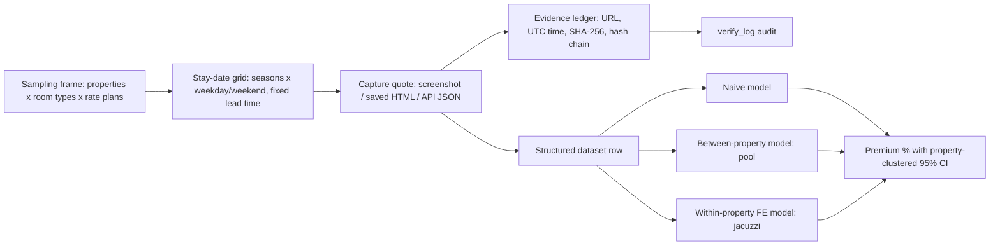

> **Proprietary - All Rights Reserved, licensed to Sandeep Grover. No reuse without written permission. See LICENSE.**

# hotel-hedonic-pricing-audit

> **SYNTHETIC ILLUSTRATIVE DATA - NOT OBSERVED HOTEL PRICES.** Every property, URL and rate in this
> repository is simulated. Property names are "Synthetic Property NNN" and URLs use the reserved
> `example.invalid` domain. Locality names only give the simulation a realistic shape.

A small runnable version of the method I would use to estimate a pool / jacuzzi room-rate premium
from an observational hotel-price dataset, with a tamper-evident evidence ledger for every quote.

## What it shows

1. **Dataset structure** - one row per quote: property x room type x rate plan x stay date, quoted at
   a fixed booking lead time (30 days), with room, property, location, season, weekday/weekend,
   cancellation and meal-plan fields (`hedonic/synthetic.py`).
2. **Two identification strategies, because the amenities sit at different levels**
   (`hedonic/model.py`):
   - *Property-level pool* is compared **across** properties. Property fixed effects cannot be used
     for it (a property either has a pool or not, so its fixed effect absorbs the pool). Controls:
     stars, review score, distance to sea, log room size, room type, locality, meal plan,
     cancellation terms and stay-date fixed effects (which absorb season and weekday/weekend).
   - *Room-level jacuzzi / plunge pool* is compared **within** the same property using property and
     stay-date fixed effects, which removes all fixed property quality and location differences.
   - A *naive* model (amenities only) is reported to show how much the controls change the answer.
3. **Clustered standard errors** - CR1 cluster-robust by property, written out in numpy and
   cross-checked against statsmodels in the tests; confidence intervals use t with G-1 df.
4. **Evidence ledger** (`hedonic/evidence.py`) - every quote gets a JSONL record with URL, UTC access
   time, stay date, lead time, capture method, capture file path, SHA-256 and byte size of the
   capture, and the hash of the previous record. `verify_log()` re-derives every hash from disk and
   reports edited records, changed or missing capture files, and broken links caused by interior deletion or reordering.

## Run

```bash
python3.11 -m venv .venv && .venv/bin/pip install -r requirements.txt
.venv/bin/python main.py          # writes output/ (CSV, captures, ledger, results, table)
.venv/bin/python -m pytest -v     # 13 tests
```
or `bash run_all.sh`. Teardown: delete `output/` and `.venv/`.

Pinned versions (checked against PyPI on 2026-10-20): numpy 2.4.6 (2.5.x needs Python 3.12; this
environment is 3.11), pandas 3.0.6, statsmodels 0.15.0, scipy 1.17.1, pytest 9.1.1.

## Workflow



## Files

| File | Purpose |
|---|---|
| `hedonic/synthetic.py` | Simulates the panel with known true premiums (pool 10.5%, jacuzzi 16.2%) and built-in confounding (pools likelier at higher-star properties, jacuzzis likelier in suites). |
| `hedonic/model.py` | Design matrices, OLS, CR1 clustered SEs, the three specifications, premium % = exp(b) - 1. |
| `hedonic/evidence.py` | Evidence record schema, append-only hash-chained ledger, independent re-verification. |
| `main.py` | Runs everything and writes `output/regression_table.md` and `output/results.json`. |
| `tests/` | Recovery of the true premiums across seeds, statsmodels cross-check, tamper detection. |

## Limits of this demo

Simulated data has no unobserved quality that is correlated with the pool after controls, so the
between-property estimate is unbiased here by construction. With real data that assumption has to be
argued and probed (review sub-scores, renovation year, photos/room descriptions, sensitivity checks).


## Evidence security boundary

Hashes show consistency against recorded digests; they do not prove source truth or prevent an editor from replacing both files and digests. The unanchored demo chain cannot detect truncation of its final records or a completely recomputed chain. Production use requires a separately retained, trusted terminal digest and expected record count (or signed, timestamped immutable archive manifest). The demo does not implement that external trust service.
